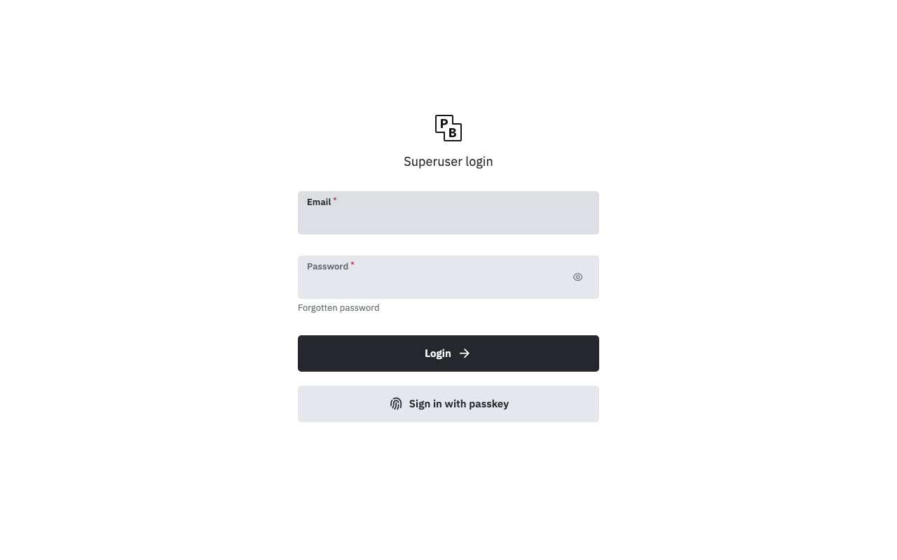
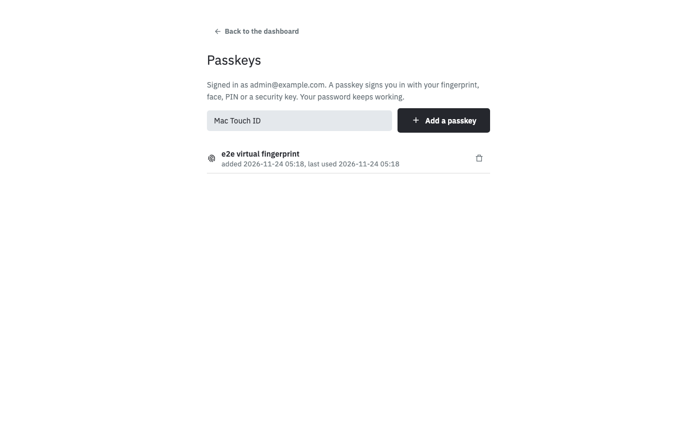

# passkey: sign in to PocketBase with a fingerprint

A PocketBase plugin that adds **passkey (WebAuthn) sign-in**: Touch ID, Face ID, Windows Hello, an
Android fingerprint, or a hardware security key.

- A plugin, like PocketBase's own `jsvm` or `migratecmd`: **no core file changes**. It is its own
  Go module and builds against upstream `github.com/pocketbase/pocketbase`, so a PocketBase update
  is a `go get -u`, nothing to re-patch.
- Dashboard button: **"Sign in with passkey"** on the `/_/` login page, and a **Passkeys** page to
  add and remove your passkeys. The password keeps working.
- REST routes for your own app: `/api/passkey/*`, answering like `auth-with-password` (`{token, record}`).





## Install

```
go get github.com/nat-build-with-oracle/pocketbase/plugins/passkey
```

Or download a ready-to-run PocketBase with the plugin from the
[releases](https://github.com/nat-build-with-oracle/pocketbase/releases) (tags `plugins/passkey/v*`).

Or run the container (linux/amd64 + arm64, built on every push):

```
docker run -p 8090:8090 -v pb_data:/pb/pb_data \
  -e PB_PASSKEY_RP_ID=pb.example.com -e PB_PASSKEY_ORIGINS=https://pb.example.com \
  ghcr.io/nat-build-with-oracle/pocketbase-passkey:latest     # or :edge for the branch head
```

Put an https reverse proxy in front: passkeys need https at `PB_PASSKEY_ORIGINS`. Without the two
variables PocketBase runs as usual and the passkey routes answer 503.

## Quick start

```go
package main

import (
	"log"

	"github.com/nat-build-with-oracle/pocketbase/plugins/passkey"
	"github.com/pocketbase/pocketbase"
)

func main() {
	app := pocketbase.New()

	passkey.MustRegister(app, passkey.Config{
		RPID:        "pb.example.com",                   // the host name users open
		Origins:     []string{"https://pb.example.com"}, // where pages run the ceremonies
		AdminButton: true,                               // dashboard button + /_/passkeys page
	})

	if err := app.Start(); err != nil {
		log.Fatal(err)
	}
}
```

Try it on your own machine (no https needed for `localhost`):

```
go run ./examples/base serve                  # binds 127.0.0.1:8090
open http://localhost:8090/_/                 # localhost, not 127.0.0.1: an IP is never a valid passkey RP id
```

1. Sign in with your password, click **Passkeys** (bottom left), **Add a passkey**, touch the sensor.
2. Sign out, then **Sign in with passkey** on the login page.

| Route | Who | What |
|-------|-----|------|
| `POST /api/passkey/register/begin` | signed-in record | `{sid, options}` for `navigator.credentials.create` |
| `POST /api/passkey/register/finish?sid=&name=` | signed-in record | body: the credential; stores it |
| `POST /api/passkey/login/begin` | anyone | `{sid, options}` for `navigator.credentials.get` |
| `POST /api/passkey/login/finish?sid=[&only=<collection>]` | anyone | body: the assertion; answers `{token, record}` |
| `GET /api/passkey` | signed-in record | `{configured, items}`: its passkeys |
| `DELETE /api/passkey/{id}` | signed-in record | removes one of its passkeys |
| `GET /api/passkey/where` | anyone | `{origin}`: the address where passkeys work |

`admin.js` holds a complete browser client (base64url conversions, both ceremonies) you can copy.

## Configuration

| `Config` field | Default | Meaning |
|----------------|---------|---------|
| `RPID` | `""` | Relying-party id: the host name, no scheme or port. Empty with a loopback bind = `localhost` |
| `Origins` | `nil` | Full origins allowed to run the ceremonies, e.g. `https://pb.example.com:8443` |
| `RPDisplayName` | app name | Shown by some authenticators |
| `AuthCollections` | `["_superusers"]` | Auth collections whose records may use passkeys, e.g. add `"users"` |
| `CollectionName` | `"_passkeys"` | System collection that stores the credentials |
| `MaxPerRecord` | `10` | Passkeys per record |
| `AdminButton` | `false` | Dashboard login button + `/_/passkeys` page (superusers only) |
| `CanManage` | `nil` | `func(e *core.RequestEvent) error`: narrows who may add, list and remove passkeys (e.g. a role field); an error answers 403. Login is not affected |

With no RPID and a non-loopback bind, every ceremony answers `503` and the buttons explain why.
`examples/base` reads `PB_PASSKEY_RP_ID` and `PB_PASSKEY_ORIGINS` (comma-separated).

## Security notes

- **HTTPS required** (or `http://localhost`): WebAuthn runs only in a secure context, with a valid
  certificate for `RPID`. A reverse proxy (Caddy, nginx) or `tailscale serve` in front of PocketBase works.
- **User verification required** on both ceremonies: a key that only taps, without a fingerprint,
  face or PIN, is refused.
- **Discoverable login**: `login/begin` names no account and lists no credentials. The authenticator
  returns its user handle (`<collection>:<record id>`) and the signature is accepted only with a
  credential stored for that same record, so one account's passkey never signs another in.
- Every login failure gives one answer (`401 Passkey sign-in failed.`): nothing says which accounts exist.
- Challenges live in memory for 5 minutes and are used once (at most 200 waiting at once).
- Credentials sit in a **system** collection with no API rules; changes go only through the routes
  above, where the owner is always the signed-in record. Only signed-in records add passkeys, so a
  passkey always starts from a password (or other) sign-in.
- The dashboard is not modified: its `index.html` is served with one extra `<script src>` (a file on
  the same origin), under PocketBase's own Content-Security-Policy. A test fails if upstream changes
  that policy.

## Notes

- One PocketBase build, two ways in: the password and every passkey of the account.
- Passkeys are bound to `RPID`: moving the server to a new host name means adding passkeys again.
- Dashboard sessions are the dashboard's own (`localStorage["__pb_superusers__/_"]`); signing out
  works as usual.

## Development

```
git clone https://github.com/nat-build-with-oracle/pocketbase && cd pocketbase && git checkout passkey
cd plugins/passkey
go test ./...                      # software authenticator: real P-256 keys, CBOR, signatures

# end to end in headless Chromium with a virtual fingerprint (CDP WebAuthn):
go run ./examples/base superuser upsert admin@example.com <password> --dir /tmp/pk
go run ./examples/base serve --dir /tmp/pk &
cd e2e && bun install && BASE=http://localhost:8090 EMAIL=admin@example.com PASSWORD=<password> bun passkey.e2e.mjs
```

The fork keeps `master` identical to upstream PocketBase. This plugin lives on the `passkey` branch,
in its own folder and module, so upstream merges never touch it. Release: tag `plugins/passkey/vX.Y.Z`
(the Go module version); CI tests it, attaches PocketBase + passkey binaries for Linux, macOS and Windows,
and pushes `ghcr.io/nat-build-with-oracle/pocketbase-passkey:X.Y.Z` and `:latest`. Every push to the
`passkey` branch pushes `:edge`.

License: MIT, like PocketBase. Uses [go-webauthn](https://github.com/go-webauthn/webauthn) (BSD-3-Clause).
